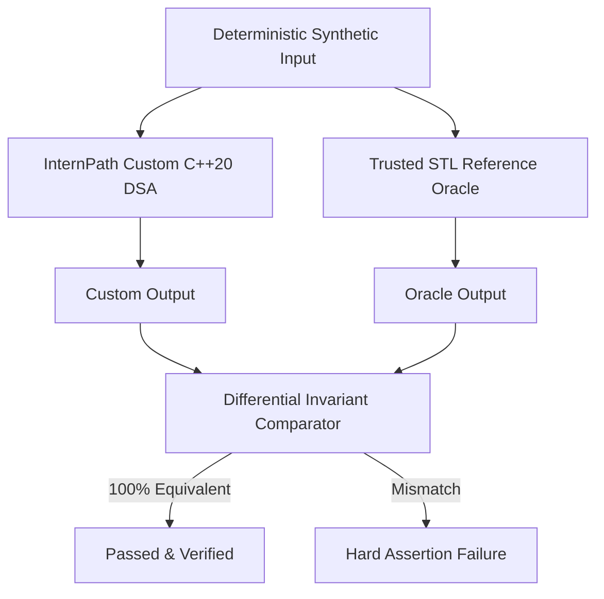

# InternPath — Benchmark Methodology & Scientific Testing Architecture

This document defines the formal methodology, measurement instruments, resource controls, and differential verification oracles used to stress test InternPath's custom C++20 Data Structures and Algorithms.

---

## 1. Experimental Environment & Hardware Profile

All empirical measurements were captured on the development host under consistent operating conditions:

| Parameter | Specification |
|---|---|
| **Processor** | 13th Gen Intel(R) Core(TM) i9-13900H (14 Cores: 6 Performance Cores + 8 Efficient Cores, 20 Logical Threads) |
| **Microarchitecture** | Raptor Lake (x86_64, 24MB Intel Smart Cache, Max Turbo 5.40 GHz) |
| **Physical Memory (RAM)** | 16.0 GB DDR5 (15.63 GiB usable, 128-bit dual-channel) |
| **Disk Subsystem** | Fast NVMe PCIe 4.0 SSD (Drive E: 59.3 GB free workspace) |
| **Operating System** | Microsoft Windows 11 Home / Pro (64-bit, Build 26100) |
| **Compiler** | GCC 14.2.0 (MSYS2 UCRT64 x86_64-w64-mingw32) |
| **C++ Standard** | C++20 (`-std=c++20 -Wall -Wextra -Wpedantic`) |
| **Optimization Level** | Release `-O3 -DNDEBUG` with `-static-libgcc -static-libstdc++` |

---

## 2. Measurement Instruments & Safety Controls

### 2.1 Monotonic Timing Instrument
- Timings are recorded using `std::chrono::steady_clock` (guaranteed monotonic, nanosecond tick resolution).
- Measurement harness:
  $$\text{Latency} = t_{\text{end}} - t_{\text{start}}$$
  $$\text{Throughput} = \frac{N \times \text{iterations}}{\Delta t_{\text{total}}}$$
- Warm-up iteration: When benchmark routines are non-state-mutating, a single unmeasured warm-up cycle is executed to ensure CPU instruction/data cache priming and branch predictor training.

### 2.2 Memory Counters & Resource Telemetry
- Windows Win32 API `K32GetProcessMemoryInfo` queries `PROCESS_MEMORY_COUNTERS_EX`:
  - **WorkingSetSize**: Current physical RAM committed to the process.
  - **PeakWorkingSetSize**: Maximum historical RAM occupied.
  - **Memory Delta**: $\Delta \text{RSS} = \text{Peak}_{\text{final}} - \text{Peak}_{\text{initial}}$.
- Host Memory Protection: `GlobalMemoryStatusEx` is evaluated prior to scaling runs. If available system RAM drops below **3.0 GB**, testing halts immediately.

### 2.3 Statistical Aggregation
For each benchmark phase, timings are captured over multiple independent iterations (default: 3–5 iterations):
- **Min**: Best-case execution time.
- **Median ($p_{50}$)**: Robust central tendency immune to OS scheduling jitter.
- **$p_{95}$ & $p_{99}$**: High-percentile tail latency metrics under heavy load.
- **Throughput**: Sustained operations completed per second ($\text{ops/s}$).

---

## 3. Differential Correctness Oracles

To strictly ensure that high-throughput optimizations do not compromise algorithmic correctness, each custom C++20 structure is systematically validated against trusted reference oracles:

### Reference Mappings:
1. **`HashTable<Key, Value>` vs `std::unordered_map`**:
   - Compares key-value preservation across $10^3 \dots 5 \times 10^5$ insertions, deletions, and query hits/misses.
   - Internal structural invariant: $\sum \text{bucket\_sizes} \equiv \text{table.size()}$.
2. **`DeadlineAVL` vs `std::set<std::pair<int, int>>`**:
   - Verified that tree balance factor satisfies $|H_{\text{left}} - H_{\text{right}}| \le 1$ at every node.
   - Range queries validated: custom pruned subtree results $\equiv$ sorted oracle subarray.
3. **`mergeSort` vs `std::stable_sort`**:
   - Order correctness: $\forall i: \text{data}[i] \le \text{data}[i+1]$.
   - Stability invariant: Equal keys preserve initial submission sequence.
4. **`lowerBound` vs `std::lower_bound`**:
   - Returns first position index $i$ where $\text{data}[i] \ge \text{target}$.
5. **`topologicalOrder` (Kahn's Algorithm) Invariant**:
   - In a Directed Acyclic Graph, for every directed edge $(u \to v)$, $\text{position}(u) < \text{position}(v)$.

---

## 4. Synthetic Workload Generation (`tools/generate_dataset.py`)

Workloads are generated deterministically using pseudo-random seeds (`seed=42`) ensuring full reproducibility:

| Level | Name | Students | Internships | Skills | Applications | Purpose |
|---|---|---|---|---|---|---|
| **Level 1** | Mini-Scale | 1,000 | 200 | 50 | 5,000 | Fast smoke validation and regression checks |
| **Level 2** | Department-Scale | 10,000 | 1,500 | 200 | 50,000 | Realistic single-faculty placement workload |
| **Level 3** | Campus-Scale | 100,000 | 10,000 | 500 | 500,000 | National university internship coordination |
| **Level 4** | National Stress | 1,000,000 | 50,000 | 1,000 | 5,000,000 | Extreme scale stress testing host memory limit |

### Domain Referential Integrity Constraints:
- **Acyclic DAG Generation**: Skills are partitioned into hierarchical tiers ($0 \dots 4$). Edges strictly originate from tier $i$ to tier $j$ ($i < j$), guaranteeing DAG acyclicity by construction.
- **Proficiency & Requirements**: Student proficiencies ($0 \dots 3$), requirement levels ($1 \dots 3$), weights ($1 \dots 5$).
- **Frozen Fit Calculations**: Application submit-time fit fractions are computed strictly using domain integer arithmetic:
  $$\text{Contribution} = w \cdot \min(\text{level}_{\text{student}}, \text{level}_{\text{req}}) \cdot \frac{6}{\text{level}_{\text{req}}}$$
  $$\text{Denominator } D = 6 \sum w, \quad \text{Numerator } N = \sum \text{Contribution}$$
- **Calendar Consistency**: Deadlines are validated forward-looking integer dates ($YYYYMMDD$).

---

## 5. Adversarial Workload Presets

1. **Adversarial Sort (`--adversarial tie_break`)**:
   - Generates 100,000 applicant records with identical fit numerators, forcing multi-key fallback evaluations (`submitSequence ASC`, `id ASC`) and proving stability.
2. **Adversarial AVL (`--adversarial monotonic_avl`)**:
   - Generates deadlines in strictly increasing and decreasing sequential order, forcing rebalancing rotations (RR and LL single rotations, LR and RL double rotations) on every node insertion.
3. **Adversarial Graph (`--adversarial dense_dag`)**:
   - Generates high edge-density DAGs (3x standard edges) to test DFS stack depth and Kahn's queue throughput.
4. **Hotspot Internship (`--adversarial hotspot`)**:
   - Concentrates thousands of applicants onto a single internship with small capacity, stress testing doubly-linked waiting list creation, middle-node unlinking, and head promotion.
